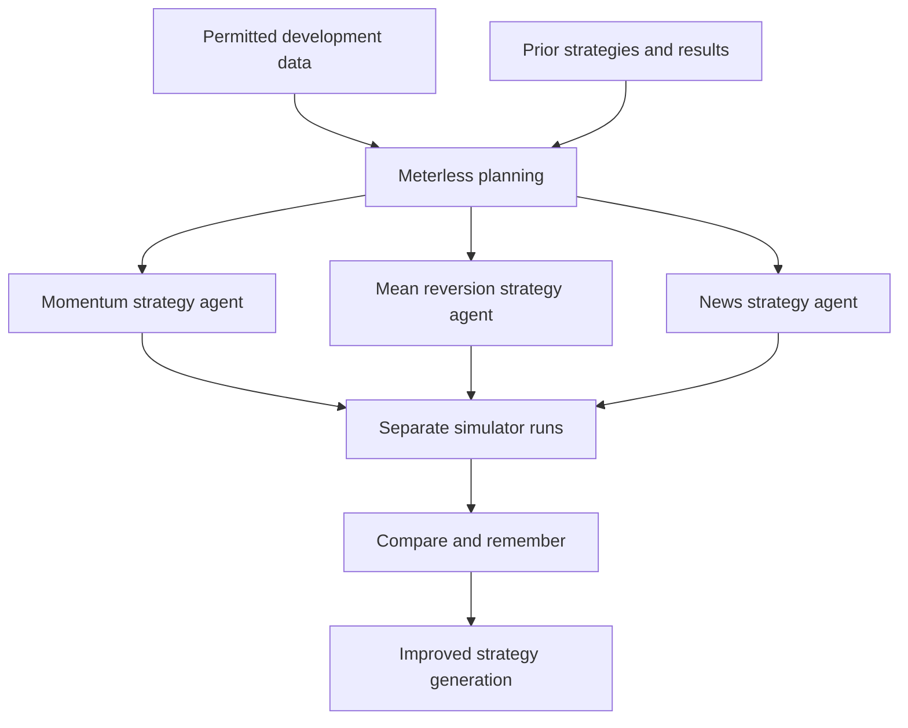
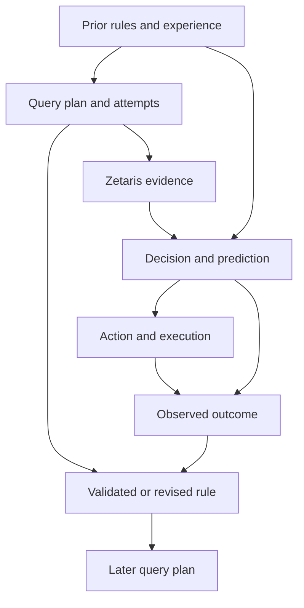

# AI Trader: Learning to query a growing Zetaris knowledge base

Oct 22, 2026 · Sai Ramsankar & Prahit Yaugand

## Project goal: Reasoning Architecture

Build this project for Track 03, Reasoning Architecture, in the [Open Agent Hackathon 2026](https://hackathon.genai.works/event/open-agent-hackathon-2026). The intended contribution is an inspectable learning loop: timestamped market context becomes SQL analysis, linked experience, multi-agent strategy plans, executable actions and simulator-verified feedback that improves later strategies. Novelty and improvement are hypotheses to demonstrate with comparisons, not established results.

Zetaris is the primary market-intelligence layer and growing knowledge base: strategy decisions and improvements are grounded in evidence joined across market, news, financial-event and simulator-result sources. Meterless remembers decision-to-outcome experience and analytical rules that guide what to query next; Nemotron plans explicit queries, interprets evidence and generates actions. The central hypothesis is that these learned analysis policies improve use of accumulating data while the model weights remain fixed.

The intended users are developers and researchers evaluating adaptive trading agents. A demo should show one complete strategy revision with linked evidence and measured outcomes, together with timing/reset checks and ablations. The published rubric allocates 30 points to impact, 20 to technical implementation, 15 to originality, 15 to demonstration, 10 to product experience and 10 to sponsor technology use.

## What each tool is good for

The simulator/evaluator is an independent market environment. In historical mode it replays archived prices, news and financial context as simulated time advances. In live-market paper mode an evaluator-side research agent collects current news and context using internet access. Both modes time-gate their feeds, execute submitted actions and evaluate performance independently of the trading agents. Each run starts the agent with configurable cash `initial_cash = K`. The agent has no web-search or general internet access. It analyzes simulator-released data through Zetaris SQL and persists analytical records there. Meterless coordinates multiple strategy agents, remembers decisions and results, combines useful findings, and proposes improved strategies for further simulator evaluation.

**Zetaris (primary market-intelligence layer).** The simulator publishes released prices, news, financial inputs, contextual material and execution feedback into agent-readable tables or views. The agent uses Zetaris SQL to collect relevant records, join and analyze them, and write features, hypotheses, predictions and learned findings into its own workspace. The [Zetaris SQL Guide](https://kbase.zetaris.com/knowledge/sql-guide) documents retrieval, table creation, inserts and access grants; [row-level access controls](https://kbase.zetaris.com/knowledge/controlling-row-level-access) are also documented. Confirm the required reads, writes and permissions on the team's actual instance and chosen storage. Zetaris is the SQL access layer; the configured writable source or lakehouse persists the tables. Store structured analytical records and decision-history nodes/edges there. Meterless manages retrieval, working context and summaries over those records through a project adapter; a native Meterless-to-Zetaris memory connector is not assumed.

**Meterless (shared memory and improvement).** Meterless remembers decisions, outcomes, and analytical rules, retrieves the ones that apply to the current context, and carries those into the next Zetaris question. Nemotron writes the SQL and the candidate. The simulator scores it. Our strategy-search controller, trading-history graph, and feedback integration are components to implement and verify. A parallel writing swarm is not the planner: it does not join released prices, filings, and trial results, and it does not enforce the simulator cutoff.

**Nemotron (AI model).** Use NVIDIA Nemotron for the trading agents and the reasoning stages used to plan, critique, synthesize and reflect. Pin the actual model ID, serving endpoint, version and inference settings; use the same model in baseline, intermediate, final and ablation comparisons. The [hackathon programme](https://academy.genai.works/courses/open-agent-hackathon-2026/details) describes using Nemotron through Meterless, and [NVIDIA publishes usage examples](https://docs.nvidia.com/nemotron/0.1.0/use-case-examples/Simple%20Nemotron-3-Nano%20Usage%20Example/README.html). Verify the chosen integration and fixed-JSON behavior. Here a trained checkpoint includes its evolved strategy, prompts and permitted memory; model-weight fine-tuning is not implied unless separately configured.

The agent's SQL identity can read only its released feed and its own workspace. It cannot read unreleased market data, modify source facts or official results, administer connections, or use Zetaris connectors to reach the public web. All outside context originates from the environment: the simulator in historical mode or the evaluator-side research service in live mode. Trading agents later retrieve and reorganize that context through SQL without gaining browsing access.

The simulator must work without Meterless, an LLM or any particular quant agent. A simple scripted agent must be able to use the same interface.

## Data — Zetaris: the primary market-intelligence layer

In the full system, Zetaris is where agents build the evidence for decisions and choose what to investigate next. Its role includes joining independently registered sources, common definitions and controlled access. The [official platform overview](https://www.zetaris.com/cloud) describes federated access and a semantic layer. Our financial data products, timestamp rules and provenance are project work, not prebuilt trading features.

Keep complementary sources distinct where practical: price history in versioned files/object storage, news/filings in a timestamped article store, financial/company events in structured tables, and simulator orders/results in an evaluator-owned ledger. Register the sources in Zetaris and expose the agent's permitted released objects. In a historical run, all registered sources use pinned versions and the simulator-controlled availability cutoff; federation must not expose today's changing source behind a frozen historical feed.

| Project data product | Inputs joined through Zetaris | How it drives behavior |
| --- | --- | --- |
| `decision_context` | Released prices, news, company events and current permitted portfolio state | Supplies a strategy agent's evidence at decision time |
| `strategy_performance_by_context` | Completed development-trial results, entry-time features and company/event classifications | Identifies contexts where a candidate succeeds or fails and guides the next experiment |
| `strategy_lineage_evidence` | Version/parent records, SQL analyses and available outcomes | Grounds Meterless's remembered lessons and proposed combinations in traceable records |
| `evaluation_report` | Evaluator-owned account/fill ledger, checkpoint IDs and fixed evaluation metadata | Supports comparison plots and traceable reports without letting agent-written notes alter scores |

For example, a development query could ask: “Across completed trials, how does momentum behave near earnings events in different volatility levels and sectors?” Zetaris joins the relevant sources; Meterless uses the returned evidence to propose an earnings filter or different position-sizing rule; Nemotron produces the revised policy/actions; the independent simulator evaluates it. The result is registered for later eligible analysis. This is a proposed experiment, not a measured finding or proof of causality.

Every substantive action or strategy revision should reference its decision-time SQL/query IDs and source records, alongside retrieved memory IDs. Define ticker/entity mappings, currency, time zones, feature windows and result units once in the shared data model. Keep direct CSV/vendor access out of the full agent's analytical path. The simulator can still execute independently on its private market replay; that independence does not give the quant agent an alternative unrestricted research feed.

The simulator/research service decides when information becomes available. Project-managed released tables/views and enforced permissions then limit what Zetaris can expose to each run and decision. Do not rely on agents writing their own date filters. Memory summaries and joined trial statistics must obey the same cutoff, including the availability of measured outcomes.

Demonstrate a cross-source join, its evidence record, an experiment it motivates, and the independently measured result. In the without-Zetaris ablation, rebuild equivalent data access/joins over the same inputs with the declared local backend. Compare correctness, time controls, freshness, implementation/query cost and trading outcomes without deliberately weakening the replacement.

## Learning to query the growing knowledge base

The knowledge base contains all eligible history, not just the newest news digest. Retain released article versions, prices, filings, company events, completed permissible outcomes and agent-generated analyses in persistent sources exposed through Zetaris. Preserve raw content alongside derived features and source references. As the environment releases more records, the agent can investigate longer histories, compare similar events and join news with subsequent observed market behavior. Every query still sees only its decision-time snapshot and permitted prior experience.

The learned object includes an **analysis policy**: when to query, what information is missing, which sources and entities to join, the appropriate lookback and comparison group, and whether the returned evidence supports a decision. This evolves through versioned prompts, retrieved experience and rules under Meterless. Keep it identifiable separately from the trading policy and the fixed Nemotron model so each contribution can be tested.

### Zetaris as an independent tool

Implement a project adapter named `zetaris_query`; this is a proposed application interface, not a claimed native Meterless API. Analysis prompts go to Nemotron. Nemotron calls the adapter with an explicit question/analysis goal, SQL and parameters; Zetaris executes authorized SQL. Keep this read tool separate from the scoped write path for the agent's own analyses and from the fixed JSON order interface.

The adapter binds the run and decision request to a server-controlled `as_of`, authorized objects and source versions. An agent-supplied parameter cannot advance that cutoff. Enforce the boundary through released objects and database permissions, with query timeouts, result limits and a declared per-decision call budget. Return results or structured errors, result/provenance references and a query ID. Historical replay can pause during analysis; live evaluation charges real query and inference latency.

| Query record | Required evidence |
| --- | --- |
| Task and context | Run/request/query IDs, analysis goal, policy/memory versions, retrieved rule IDs and server-bound cutoff |
| Attempt | SQL and parameters, authorized source/view versions, joins and feature windows; failed and retried calls retained |
| Response | Rows or immutable result reference, provenance, result hash, truncation/error status and timing |
| Use and feedback | Decision/evidence references, short stated interpretation, orders, later eligible outcomes and any rule revision |
| Resources | Tool calls, retries, returned rows, model tokens/cost and end-to-end latency |

Do not require disclosure of model-internal reasoning. Record the intended analysis and the explanation the agent chooses to provide, then assess it against returned evidence. Correctly executing SQL can still answer the wrong question or produce an unsupported interpretation.

### What an analysis rule can teach

Suppose an agent reacts to a price jump after an earnings headline. An earlier decision/outcome record may suggest checking whether the move was market-wide, whether similar earnings events had already reversed, and whether the proposed trade survives costs. Meterless can retrieve a provisional rule to query sector-relative returns, archived company news and completed eligible comparisons before acting. Nemotron chooses the SQL and may reject the trade if the returned evidence is weak. This is an example of intended behavior, not an observed profitable rule.

Store query-planning rules separately from trade-entry or sizing rules. Each rule needs conditions, intended analysis, support, counterexamples, sample/window definitions, uncertainty and a version. A rule can improve evidence selection without prescribing a trade. Correlation estimates need sample counts, event windows, comparators and uncertainty; news/return association does not prove causation. Search over many filters also creates selection bias, so validate proposed rules on later development windows.

### Relationship to the supplied paper

[Co-LMLM](https://arxiv.org/abs/2607.07707) trains continuous hidden-state retrieval while externalizing factual knowledge. This project instead uses a fixed Nemotron model, explicit SQL calls and memory-based adaptation. Treat it as inspiration, not a reproduction; its factual-QA evaluation does not establish trading performance.

Choose Nemotron by measured reasoning, SQL and resource performance. An open model is not inherently weak, and external storage does not eliminate the need to plan queries, interpret statistics and handle uncertainty. It also does not remove facts already memorized during pretraining.

## How the pieces connect

The base interaction is a timed sequence of data releases, JSON decision prompts, agent SQL analysis, JSON actions and simulator feedback.

1. **The simulator initializes the run.** Set the dataset, start/end times, initial cash `K`, costs, position limits, mode, decision cadence and time scale. Initialize cash to `K`, positions to empty, and the agent's run-scoped data workspace. Restore the selected pre-test checkpoint and its permitted training memory, then create fresh writable runtime memory for this run. Never seed a test with another test run's learned state.
2. **The simulator collects and releases data.** Its internet-enabled collectors obtain prices, news and contextual inputs. During historical replay, the private dataset is frozen and versioned. At simulated time t, the simulator releases only records available by t into the agent's Zetaris feed. Collecting historical context today does not make later information eligible for an earlier decision.
3. **The simulator issues a fixed JSON decision prompt.** Include the decision ID, simulated timestamp, permitted data cutoff, current account, planning window, time scale and names of accessible SQL objects. Bind SQL reads for that decision to the same cutoff, even if ingestion continues in the background.
4. **Memory guides analysis; Zetaris supplies evidence.** Meterless retrieves eligible past decisions, query attempts, outcomes and analytical rules for the current context. Nemotron identifies missing evidence and calls the independent Zetaris query tool over permitted data products. It interprets the response and records query/rule IDs, evidence references, stated rationale, prediction and selected action as linked graph records. These analyses are agent-generated; official executions and results still come from the simulator.
5. **The agent returns fixed JSON actions.** V1 returns immediate orders or hold once per decision minute. V2 returns a timestamped plan of orders for the coming minute. The agent chooses the trade timings inside V2's permitted window.
6. **The simulator executes and evaluates; memory records the experience.** The simulator validates and executes orders, updates the portfolio and releases feedback. The agent-side memory adapter then links released fills, rejections and observed outcomes to the original decision and action. Meterless can retrieve that experience at later decision boundaries. The final official report remains independently produced by the simulator.

The interface carries more than a strategy spec and a final score:

| Direction | Information |
| --- | --- |
| Simulator to Zetaris feed | Prices, news, financial context and feedback released by the current simulated time |
| Agent to Zetaris | SQL reads over released data; SQL writes of analyses and decision-history records into its workspace |
| Agent to Meterless | Remember decision/action/result links; retrieve past experiences and assemble bounded working context |
| Simulator to agent | Fixed JSON decision prompt: time, cash, positions, data cutoff and planning window |
| Agent to simulator | Fixed JSON immediate orders (V1), scheduled orders (V2), or an empty order list for hold |
| Simulator to agent | Accepted/rejected orders, fills, portfolio updates and the next decision prompt |
| Simulator to evaluator | Final performance report and reproducible action/execution log |

A proposed interface is `reset(run_config) -> decision_request`, `submit_action(action_json) -> acknowledgement`, simulator-driven event advancement, and the next decision request plus an end-of-run report. Zetaris SQL supplies historical data and structured persistence; Meterless supplies the agent's memory retrieval and context-management interface. Decision requests, order responses and acknowledgements use versioned JSON schemas. These are project interfaces, not existing Meterless APIs.

The agent can write to its own Zetaris workspace, but cannot write to the simulator's source market dataset, advance the clock, change execution rules or calculate its own official score. Requesting a future execution time schedules an order; the simulator remains responsible for advancing to that time. The simulator does not import the agent implementation; a runner connects them through the shared interface.

## Meterless strategy search and improvement

There are two loops. The development loop generates and improves strategies across simulator runs. Inside each run, a strategy agent follows the existing V1/V2 minute-based observation/action protocol. Meterless coordinates development and shared memory; the simulator remains the independent environment and evaluator.



1. **Combine data and remembered experience.** Analysts use Zetaris SQL over permitted development data. Meterless retrieves previous strategies, decisions, evaluation results, failures and lessons. Its planner identifies which hypotheses or combinations to investigate next.
2. **Create distinct candidate strategies.** Assign strategy agents different hypotheses, such as momentum, mean reversion, news-driven trading, or different risk/sizing rules. Each candidate is a versioned policy/configuration with declared inputs, entry/exit behavior, timing, position limits and parent strategy IDs. Its output during a run is still the fixed JSON action format.
3. **Run candidates independently.** Give each strategy its own simulator account starting with `K`, isolated run state, and the same declared market/news data, decision cadence, costs and execution assumptions. Candidates can run concurrently under a configured budget; they do not spend one another's capital or change the simulator. Keep decision-time memory scoped to the candidate run and its permitted prior experience.
4. **Compare actual results.** The simulator returns fills, portfolio history and performance. Meterless records both successful and failed candidates and links results to their strategy versions, decisions and market conditions. Choose the ranking objective and risk constraints before search; compare validation results across several declared windows rather than ranking solely by one run's profit.
5. **Synthesize new candidates.** Meterless combines supported findings into a new version: for example, a news-confirmed momentum entry with sizing rules learned from a lower-drawdown candidate. It may propose a strategy selector based on currently observable conditions or a portfolio allocation across strategies. A combination is a new candidate and must be rerun with total capital `K`, combined exposure and transaction costs. Adding individual returns or concatenating orders does not establish the combination's performance.
6. **Verify, repeat and promote.** A critic checks evidence, inconsistent rules, duplicated ideas and risk limits. Reevaluate proposed improvements, store parent/child links and the changed components, and repeat until the generation/run/token budget is exhausted or validation improvement stalls. Promote the best validated candidate or ensemble for a separate forward evaluation.

A strategy-search round is completed only after its results are stored and the next generation uses those results. Summarizing several agents' opinions without simulator comparison does not demonstrate learning. Retaining previous versions and failed trials makes it possible to assess which changes helped and to revert a regression.

**Keep future results out of current decisions.** Search and repeated replay operate on declared development windows. They cannot branch into the actual future of an ongoing evaluation, inspect which candidate earns most over the next minute, and then choose that candidate for the current minute. In evaluation, a selector can use only released data and outcomes already observed. Freeze development-derived policies and permitted seed memory before the locked test; any allowed online adaptation then uses only progressively released feedback. Do not share one evaluation candidate's future or completed full-period score with another candidate still making earlier decisions.

The goal is to discover strategies that perform well after costs and risk constraints on unseen periods. Memory supports empirical improvement and condition-specific selection; it does not prove a globally optimal trading strategy or guarantee future returns. Claims about the benefit of synthesis must compare the merged candidate with its parents under the same protocol.

## Meterless memory: queries, decisions, outcomes and rules

Meterless should remember both strategy-development lineage and each agent's analysis/trading experience: what it asked, what evidence came back, what it decided, what actually happened and which rule should be retained or revised. Preserve complete successful and failed attempts as a directed acyclic graph (DAG), with bounded retrieval for working context. The graph is application data managed by our agent-memory integration.



A decision can use multiple articles, SQL analyses and prior lessons, and can produce multiple scheduled actions. Several actions can contribute to a later portfolio outcome. A prediction remains pending until its evaluation horizon and the required simulator feedback have arrived. Keep the original prediction and decision intact when a later result disagrees with them.

| Record | What it preserves |
| --- | --- |
| Strategy/evaluation | Version and parent IDs, policy/configuration, changed components, development windows, simulator results, validation scores and promotion status |
| Query attempt/result | Analysis goal, SQL/parameters, cutoff, policy/rule IDs, returned evidence, errors/retries and resource use |
| Evidence/analysis | Released data IDs, SQL query/result references, features and input cutoff |
| Decision/prediction | Decision ID, stated rationale, expected result and horizon, selected plan and retrieved-memory IDs |
| Action/execution | Order IDs, scheduled activation, simulator acknowledgement, actual fills, costs or rejection |
| Observed outcome | Simulator-sourced portfolio/result observations, their measurement interval and availability time |
| Lesson/analytical rule | Trigger conditions, recommended investigation or behavior, supporting cases and counterexamples, uncertainty, sample/window/regime, validation status and prior version |

Store complete node/edge records in the agent's writable Zetaris workspace. Give every decision a strategy-version ID. Link parent strategies to a newly synthesized version and link each completed evaluation to its exact version. Merge lineage may have several parents, but new versions and events keep the graph acyclic. Each node has a stable ID, type, run/decision IDs, content or a payload reference, simulated creation/availability time and provenance. Each edge has source and destination IDs, a relation type, creation/availability time and run scope. Meterless holds or indexes eligible summaries and record references for retrieval; its context/index state can be rebuilt from the durable records. A successful trade alone is not proof that a news item caused its price movement: graph links record evidence and decision lineage, with hypotheses labeled as hypotheses.

At each decision boundary:

1. Read the decision's current account, cutoff and available schema.
2. Use Meterless to retrieve relevant previous analyses, decisions, known results and rules, including analogous failures and unresolved predictions. Follow linked evidence when detail is needed.
3. Assemble bounded context, identify the information needed, and query Zetaris within the declared call budget. Record failed attempts, returned evidence and its interpretation. References point back to complete records rather than resending the full transcript.
4. Generate the fixed JSON action/plan and save its decision record before submission. Capture stated rationale and predictions; model-internal reasoning is not required.
5. As the simulator releases feedback, append execution/outcome nodes and links. Update working context and append revised lessons for later decisions.

Historical records are append-only. A revised lesson becomes a new node, and a later decision can reference it; never rewrite an earlier decision to include facts learned afterward. Keep graph edges in the direction of the recorded event sequence so the graph remains acyclic. An administrative link to an older record is represented by a new revision node with an edge from the older version.

Enforce the same simulated-time cutoff on graph nodes, edges, retrieved summaries and Meterless memory as on market data. A result learned at 14:05 must not influence the 14:01 decision, even if a full graph was indexed during a later replay. Use run-scoped memory, or explicitly version and authorize prior experience from an earlier eligible period. Retained memory is part of the agent's permitted information, not a bypass around the simulator's time rules.

The strategy-lineage and decision-history graphs record how candidates, decisions, and outcomes inform later versions. Those records live in the agent workspace and are read back through Zetaris. Meterless holds the eligible summaries and record references used to choose the next query. First demonstrate remember, retrieve, outcome-linking, restart recovery, and cutoff enforcement with the available Meterless build. Its memory APIs and our SQL synchronization have not been demonstrated by this document update.

## News and web context as a time series

The environment owns web search, news collection and any external-context tools: archived collection/replay in simulation and the evaluator-side research agent in live mode. It builds a timestamped event stream and releases records as the market clock reaches their availability time. The agent has no web-search tool; it retrieves the released records through Zetaris and receives a relevant-news digest with each decision prompt.

For each article or context record, store `event_id`, relevant symbols/entities, `published_at`, `available_at`, `retrieved_at`, `released_at`, source URL, title, content and content-version ID. `published_at` is when the source published that version. `available_at` is when that version became available through the chosen source, including the declared source delay. `retrieved_at` records our collection time and does not establish historical availability. The simulator stamps `released_at` when it actually exposes the record.

Retain the released history in persistent registered storage exposed through Zetaris; do not replace it with a rolling digest. Store extracted event labels, entities, summaries and other derived features alongside raw versions, with extractor/model version, input references and their own creation/availability times. A retrospective correlation or feature computed using later outcomes cannot enter an earlier snapshot merely because its source articles were old. The environment owns source facts; the agent's hypotheses and learned associations remain labeled analytical records in its workspace.

An agent decision at time t may use a record only when `published_at <= t`, `available_at <= t` and `released_at <= t`. Reject records or revisions whose historical availability cannot be established. Keep a later edit as a new version with its own availability time; an old publication date does not make today's edited body valid for a past run. Web-search date filters alone do not enforce this rule: validate the returned page/version, title, snippet and any generated summary before release.

At each decision, prioritize news using the agent's current positions, its declared watchlist, the eligible stock universe, related sectors and general market events. Use only portfolio and watchlist state already known at that time. Released historical news remains queryable in Zetaris, so the agent can investigate a newly relevant stock without obtaining future articles. The relevance policy and digest-size limit are part of the run configuration, not selected after seeing which stocks later perform well.

Example: an AAPL article published at 14:00:35 and first available at 14:00:40 cannot appear in the 14:00:00 prompt. It can enter the released feed at 14:00:40. With minute-boundary decisions, the agent can use it at 14:01:00. In V2, its previously scheduled 14:00:45 order still follows the accepted plan; the new article does not create an extra model decision. A separate article published at 14:02 remains private until its own release time.

This prevents future information entering through the feed. The agent is still allowed to forecast future prices from past information; the requirement is to prevent foreknowledge, not prediction.

## Trading modes and the simulator clock

Use separate names for capital and acceleration: `initial_cash = K` is money; `time_scale = s` is simulated seconds per playback second. The agent receives both. A scheduled time is always a simulated-market timestamp. For example, at 60x playback, a trade scheduled 30 simulated seconds ahead becomes due after 0.5 playback seconds, excluding any configured inference pause.

Working interpretation: a decision minute and a V2 planning minute both mean 60 simulated seconds. Record `cadence_clock = simulated` explicitly. If the intended limit is one request per wall-clock minute, configure that separately and convert the planning horizon using the time scale; a minute of wall time and a minute of market time must not be silently mixed.

| Mode | Agent decision requests | Returned actions | Between requests |
| --- | --- | --- | --- |
| V1 | One at each simulated-minute boundary | Orders submitted now, or `orders: []` for hold | Simulator processes market events and fills; no additional discretionary agent decisions that minute |
| V2 | One plan request at each simulated-minute boundary | Zero or more orders with agent-chosen execution timestamps in the next 60 simulated seconds | Simulator executes the queued plan as each timestamp becomes due and continues releasing data |

V2 provides event-driven execution between prompts; the agent's planning calls remain discrete. It cannot react to news released later in that minute until the next decision request. Exchange-style limit orders may react through their predefined fill conditions, but an unplanned model decision is another request.

For historical replay, the default is to pause the decision clock during inference, pin the SQL cutoff, then resume playback with the accepted plan. In live-market evaluation, `time_scale = 1`: real market time continues during inference. Count actual latency, activate orders only after acceptance, and reject or skip expired actions; never backdate a late plan. If latency is modeled instead, apply it consistently and reject expired submissions rather than backdating them. Version the event-ordering and latency rules. The runner enforces the decision cadence; SQL tool requests inside a decision are not additional trading-decision prompts.

The initial cash balance persists across minutes and changes through trading; it is not reset at each prompt. V1's orders become eligible after acceptance. V2's orders become eligible at their scheduled times. Both fill using the execution model and available market events, not guaranteed future prices or guaranteed fills.

## Fixed JSON contract

The simulator sends a JSON decision request with `schema_version`, `run_id`, `request_id`, `mode`, `as_of`, `window_start`, `window_end`, `initial_cash`, account cash/equity/positions, clock settings, and the permitted Zetaris feed/workspace identifiers. The agent sees only data released by `as_of`. SQL is available as a separate tool during that decision; it is not embedded executable code inside an order. A proposed request is:

```json
{
  "schema_version": "1.0",
  "run_id": "run_001",
  "request_id": "decision_0001",
  "mode": "V2",
  "as_of": "2026-10-21T14:00:00Z",
  "window_start": "2026-10-21T14:00:00Z",
  "window_end": "2026-10-21T14:01:00Z",
  "initial_cash": 10000,
  "account": {
    "currency": "USD",
    "cash": 10000,
    "equity": 10000,
    "positions": []
  },
  "clock": {
    "cadence_clock": "simulated",
    "decision_interval_seconds": 60,
    "time_scale": 60,
    "execution_resolution_ms": 1000
  },
  "data": {
    "feed_schema": "feed_run_001",
    "workspace_schema": "agent_run_001",
    "news_event_ids": []
  }
}
```

Use one fixed response envelope for both modes. The examples illustrate configurable `K` with $10,000. The V1 and V2 responses below are alternatives for requests in the matching mode; only one response is accepted per request. `execution_resolution_ms` must reflect the real input-data and engine capability, rather than advertising finer fills than the data supports.

V1 response at the 14:00 decision boundary:

```json
{
  "schema_version": "1.0",
  "run_id": "run_001",
  "request_id": "decision_0001",
  "mode": "V1",
  "window_start": "2026-10-21T14:00:00Z",
  "window_end": "2026-10-21T14:01:00Z",
  "orders": [
    {
      "order_id": "order_0001",
      "execute_at": "2026-10-21T14:00:00Z",
      "symbol": "AAPL",
      "side": "BUY",
      "quantity": 1,
      "order_type": "MARKET",
      "limit_price": null
    }
  ],
  "reason": "Entry supported by analysis of the released price and news data."
}
```

V2 response for the same decision window:

```json
{
  "schema_version": "1.0",
  "run_id": "run_001",
  "request_id": "decision_0001",
  "mode": "V2",
  "window_start": "2026-10-21T14:00:00Z",
  "window_end": "2026-10-21T14:01:00Z",
  "orders": [
    {
      "order_id": "order_0001",
      "execute_at": "2026-10-21T14:00:10Z",
      "symbol": "AAPL",
      "side": "BUY",
      "quantity": 1,
      "order_type": "MARKET",
      "limit_price": null
    },
    {
      "order_id": "order_0002",
      "execute_at": "2026-10-21T14:00:45Z",
      "symbol": "AAPL",
      "side": "SELL",
      "quantity": 1,
      "order_type": "MARKET",
      "limit_price": null
    }
  ],
  "reason": "Schedule an entry and exit using information available at the start of the minute."
}
```

Return only the JSON object. Use `orders: []` for hold. Validate exact keys, types, enum values, positive quantities, finite numbers, timestamp precision and known symbols. Require the run, request and window identifiers to match the simulator prompt. V1 timestamps must equal the decision boundary; V2 timestamps must lie in `[window_start, window_end)`. An execution timestamp is an activation time, not a promise of a fill at that instant. A scheduled sell is rejected at execution if inventory is insufficient under the configured shorting rules. Bound the number of orders, reject stale/duplicate submissions, and recheck cash and position limits at execution. Record cancellations/rejections for orders that cannot execute within their configured validity period; do not silently carry an expired plan into another minute.

## Chronological learning and the latest-period testbed

Use recent years of reliable archived data, divided by time rather than shuffled rows. Define the latest complete interval as the sealed testbed `[T0, T1]`; all training and validation information used to choose policies must be from before `T0`. Choose and record the exact boundaries before development. Live evaluation instead begins prospectively after the selected checkpoints are frozen.

1. **Learn from earlier to later.** Start with an older training prefix, evaluate on the next development/validation window, and advance the cutoff chronologically. Meterless carries forward only experience available by that cutoff. A trial fitted on a revisited historical window is in-sample; evidence of generalization comes from later windows. A chronological feed limits lookahead but does not erase market history already present in a pretrained model.
2. **Save base, intermediate and final checkpoints.** Include the strategy/configuration, prompts, Nemotron model/inference settings, memory snapshot/index references, parent lineage, development-data cutoff and allowed online-adaptation rules. Preselect the intermediate generations and the final candidate before opening the testbed. “All context” means all eligible development experience, not any result from the latest test interval.
3. **Reset before every test run.** Restore that candidate's own frozen pre-test checkpoint, reset the environment to `T0` with capital `K` and the configured initial positions, and create new run IDs, SQL namespaces and writable memory/index state. Reset caches and conversation state too. Preserve the training knowledge embodied in the checkpoint; no test-derived state is restored.
4. **Allow learning within that run.** As the test progresses, the agent may store new observations, decisions, fills and lessons and use them at later times within the same run. Its update procedure is fixed before evaluation, and every new record/result remains time-gated. Account state is reset only at the start, not each minute.
5. **Seal test learning at the end.** Export test records for evaluator-only audit/plots, then discard the agent's writable test-memory layer and restore the frozen checkpoint for any preregistered repeat. Test transcripts, summaries, embeddings, graph edges, caches and learned selection weights must not feed another run, candidate or development generation. Audits remain readable by the evaluator, not by subsequent tested agents.
6. **Keep test scores outside the development loop.** Evaluate the preselected checkpoints/ablations under one declared protocol after development is frozen. Do not select another strategy, retune a prompt or continue training in response to the sealed test curve. Any later development using those results needs a new untouched future test interval.

The final agent retains its pre-test training knowledge and learns temporarily inside its own test episode. The baseline, intermediate agents, ablations and repeats each start independently from their corresponding pre-test state.

## Historical and live evaluation modes

Use an established execution/evaluation engine behind the independent environment. [HKUDS AI-Trader](https://github.com/HKUDS/AI-Trader) remains the first candidate to inspect and pin; [Backtrader](https://www.backtrader.com/docu/data-replay/data-replay/) is a local replay alternative. AI-Trader's current README mentions background market-intelligence jobs, so do not assume it has no contextual data. Its required timestamped research feed, freshness, historical controls and V1/V2 adapter still need verification.

| Mode | Market/context source | How the agent receives it | Clock |
| --- | --- | --- | --- |
| Historical replay | Frozen simulator archive of prices, news and contextual records | Simulator releases eligible events into the permitted data interface | Configured accelerated simulated time |
| Live-market paper evaluation | Live market feed plus evaluator-side research agent | Evaluator publishes newly available, sourced context through the same logical interface | Actual market time, `time_scale = 1` |

**Live research agent.** Place it on the evaluator side, separate from the agents being scored. It can search the web and query news/financial sources for company events, filings, earnings, macro context and other relevant information. Record sources, publication/version timestamps, actual first-observed time and release time. Publish summaries only from those eligible records. Collect for the declared universe and union of current holdings/watchlists of the comparison agents; provide a common timestamped feed, with the same relevance/digest rule for each agent. Do not let the researcher pass strategy advice based on later outcomes or privately observed rival performance.

If the chosen software already supplies suitable research/context tools, wrap and verify them; otherwise implement this research service and its data-release adapter. The trading agents remain unable to search directly. Historical tests use archived as-of context rather than today's research output relabeled with an old timestamp. In ablations without Zetaris, publish the same records through the replacement data backend.

The execution engine owns fills, cash, positions, costs and the official report. Reuse an inspected engine's broker/accounting where possible, and build the fixed-JSON, news-time, reset and scheduling adapters around it. Recording a caller-supplied trade price is insufficient for independent execution scoring. Live mode here means paper execution against real market data and current context.

Before adopting an engine, demonstrate a recorded small replay with known orders/costs, two V2 activation times, a delayed news release, future-query rejection, checkpoint restoration and exact action-log reproduction. In live mode, verify freshness and receipt times and keep all comparison agents on the same actual market interval. Run them concurrently, or archive that interval and label later evaluation as replay. Documentation review alone does not establish this compatibility.

## Baseline, intermediate agents, ablations and plots

Compare the unoptimized base Nemotron agent (generation 0), preselected intermediate strategy generations and the final trained checkpoint on the same latest-period testbed. Give each its own `K`, independent state, the same permitted market/context history, costs, V1/V2 cadence and execution model. Include buy-and-hold and a simple rule-based control. The checkpoints differ in eligible learned strategies/memory, while the foundation model and evaluation protocol remain fixed.

Run the tool ablations as a two-factor comparison:

| Variant | Orchestration and memory | Data/analysis backend |
| --- | --- | --- |
| Full | Meterless planning, shared memory and synthesis | Zetaris SQL and structured persistence |
| Without Meterless | Plain controller with a declared simple log/context baseline and matched strategy/trial budget | Zetaris with identical input data |
| Without Zetaris | Meterless unchanged | Local SQL/file backend over the identical time-gated data and analytical records |
| Without both | Plain controller and simple context baseline | Same replacement backend and data |

Keep Nemotron model/settings, input records, initial capital, candidate/iteration budgets, execution assumptions and evaluation dates matched. Removing Zetaris must not remove news or useful financial inputs. Record query correctness/failures, freshness, latency and governance/replay checks as well as trading results; a data platform need not increase profit by itself to contribute useful reliability. Extra memory-off or synthesis-off runs can isolate those mechanisms more narrowly. Tool ablations estimate the specified replacement's effect, not a guaranteed sponsor advantage.

**Iteration versus money made.** Plot strategy generation/checkpoint on the x-axis and evaluator net profit in account currency on the y-axis. With no deposits/withdrawals, `net_profit = final_equity - K`, after costs and consistent valuation of open positions. Include generation 0, intermediate checkpoints and final generation. During active development show validation results on comparable windows; stratify by window if they differ. After freezing the comparison set, add the sealed latest-test results as a separate labeled series. Test scores never drive another generation.

Also plot equity against market time for the selected checkpoints and provide an ablation comparison. Report return, maximum drawdown, turnover, fills/rejections, model cost and runtime alongside money made. Predeclare repeat seeds/budgets, reset each repeat, and show dispersion when there are repeats. Record at least `generation`, `checkpoint_id`, `variant`, `split`, `window_id`, `seed`, `initial_cash`, `final_equity`, `net_profit`, `max_drawdown`, `model_cost`, `environment_version` and `data_version`. Generate plots from evaluator records, without invented results or a best-run-only selection.

## Independent query-learning evaluation

Trading profit alone cannot show that the agent learned to ask better questions. Build a separate suite of analysis prompts with fixed decision-time database snapshots. Include tasks such as finding the original eligible earnings report, computing sector-relative returns over a specified window, joining prior news to completed outcomes, identifying insufficient evidence and rejecting a request that would require future data. Curate expected records, result semantics and valid interpretations using small hand-checked fixtures and held-out tasks. Do not grade primarily by an LLM's preference or by exact SQL text.

At each selected checkpoint, restore its own eligible memory/query-policy snapshot and solve the same tasks with the same model, schema, database snapshot, prompt, call/token budget and result limits. Checkpoints and their seed memories must predate the task interval; tasks must not already appear in their training transcripts. Use equivalent schema documentation for all variants. Compare adaptive query planning with fixed query templates and with memory disabled. Retain every attempt and failure. If isolating query planning, hold the downstream decision/execution policy fixed; measure the complete adaptive system separately.

| Measurement | What it distinguishes |
| --- | --- |
| SQL execution and semantic correctness | Syntactically valid calls versus answers to the intended question; compare result meaning, not SQL wording |
| Time and provenance safety | No unreleased rows, revisions, derived results or cross-run memories; traceable eligible sources |
| Evidence coverage and relevance | Necessary records/joins retrieved, omissions and irrelevant volume; correct recognition of insufficient evidence |
| Interpretation quality | Conclusions supported by rows, uncertainty reported and correlations not presented as causes |
| Efficiency and reliability | Calls/retries, redundant queries, tokens, returned rows, failures and latency under equal budgets |
| Downstream usefulness | Decision effects under a fixed policy, then independent net profit, risk and costs for the full system |

Separate **data growth** from **improved use of data** with a second controlled comparison. At a common evaluation cutoff, cross base versus learned query-policy/memory checkpoints with an earlier versus fuller eligible data snapshot. Keep source schema, model, task and budgets fixed; the fuller snapshot contains only records available by that cutoff. Freeze both checkpoints before the task interval and the release of its added records; exclude these fixtures from their experience. Verify neither checkpoint carries facts or cached results from the added records; otherwise report the condition as combined memory-plus-data access, not an isolated data-growth effect. A task may correctly be unanswerable in the smaller snapshot.

Compare base/learned policies on the same snapshot to study better use of information. Compare snapshots under the same policy to study the value of more external information, including their interaction. This deliberately changes information and is distinct from the without-Zetaris backend ablation, which must keep input information equal. Predeclare the task set, metrics and comparisons; keep sealed-task answers and test feedback out of the improvement loop.

Plot query correctness, evidence quality, calls and latency by checkpoint alongside the existing net-profit graph. Chronological learning curves alone mix changes in data, market conditions and policy; these matched tasks make the querying claim more assessable. Within-test query/rule updates follow the same disposable-memory lifecycle as trading experience.

## The traps

**Lookahead bias in the data feed and SQL.** Historical news retrieved today can contain hindsight or later revisions. Keep publication, availability and revision timestamps. Release a completed bar only once it exists. The agent's SQL permissions must expose only the run's released feed and its own causally generated records; do not rely on the agent voluntarily adding a date filter. Keep private future data and unrelated source connectors inaccessible. Pin each decision's query cutoff and reset or explicitly authorize memory across runs. The simulator's internet access does not authorize it to send future summaries or hindsight articles into an earlier prompt.

An LLM may already know historical outcomes from pretraining. A time-filtered simulator prevents data-feed leakage, but cannot remove that knowledge. Future paper trading provides a useful additional check; anonymizing tickers and dates can reduce obvious cues without proving that memorization is absent.

**Overfitting during later agent improvement.** Repeatedly modifying the agent after inspecting the same evaluation period can fit that history. Keep training, validation and locked test periods separate. Any future learning or strategy-improvement loop must preserve the simulator's independent rules and data-access boundary. Report return alongside risk metrics such as Sharpe ratio and maximum drawdown.

**Simulator realism and time resolution.** Include commissions, slippage, trading hours, cash constraints and position limits. V1 needs data appropriate for minute-based decisions. V2 needs quotes, trades or other intraminute data at the claimed execution resolution; daily or minute OHLCV alone does not identify the prices or event ordering at second 10 and second 45. A chosen timestamp becomes eligible on the first suitable market event under the execution model. Time acceleration changes playback speed, not fill quality, liquidity or market-data resolution. Match baselines to the same capital, cadence, data and costs.

**Memory integration check.** First verify how the available Meterless build can write and retrieve memory, preserve references, and restore context after restart. Connect those operations to our decision-history records and simulator feedback. The next hypothesis still comes from a Zetaris join over those records, not from a separate task scheduler.

## Next steps

- [ ] Confirm the Track 03 demo objective and configure the pinned Nemotron model for all comparison agents.
- [ ] Define the decision-request, fixed JSON action/plan and evaluation-report schemas.
- [ ] Build simulator-owned collectors for prices, news and the selected financial inputs.
- [ ] Register the distinct price, news/event and evaluator-result sources in Zetaris; verify source versions, entity/time mappings and access.
- [ ] Build joined decision context and strategy-performance data products, plus traceable SQL evidence for every action/revision.
- [ ] Retain all released news versions and timestamped derived analyses; implement the independent query adapter with intent/result/error logging.
- [ ] Create simulator-owned released-feed objects and agent-owned analysis/decision-graph tables in Zetaris; verify SQL reads, inserts and permissions.
- [ ] Connect Meterless planning and memory to strategy/decision graph records; verify recall, outcome linking, context reconstruction and restart recovery.
- [ ] Add distinct strategy agents, isolated candidate accounts and a budgeted development/validation search loop.
- [ ] Learn chronologically, save base/intermediate/final checkpoints, and seal the latest-period testbed.
- [ ] Evaluate synthesized candidates against their parents during development, then run the frozen checkpoint comparison with per-test reset and isolated runtime memory.
- [ ] Configure initial cash `K`, the one-minute decision cadence, time scale and execution resolution.
- [ ] Implement V1 immediate actions and V2 scheduled plans, with clock, data filtering, accounting, fills and metrics.
- [ ] Restrict the agent to simulator/Zetaris tools and the model runtime; verify that browsing and indirect external-data access are unavailable.
- [ ] Build archived news/context replay and a live evaluator research agent with the same time-gated data interface.
- [ ] Add full, without-Meterless, without-Zetaris and without-both comparisons plus iteration-versus-net-profit plots.
- [ ] Add held-out query tasks, matched snapshot comparisons, fixed-template/memory controls and query-quality-versus-generation plots.
- [ ] Pin an AI-Trader evaluation revision or choose a local engine such as Backtrader after the recorded-replay checks.
- [ ] Run a scripted agent through the interface and verify accounting and time limits.
- [ ] Verify that Meterless retrieves only eligible run/time context, then connect the quant agent to the independent simulator interface.

## Sources

- [Open Agent Hackathon 2026: Track 03 and judging rubric](https://hackathon.genai.works/event/open-agent-hackathon-2026)
- [Hackathon programme: Nemotron through Meterless](https://academy.genai.works/courses/open-agent-hackathon-2026/details)
- [NVIDIA Nemotron usage example](https://docs.nvidia.com/nemotron/0.1.0/use-case-examples/Simple%20Nemotron-3-Nano%20Usage%20Example/README.html)
- [Co-LMLM: Continuous-Query Limited Memory Language Models](https://arxiv.org/abs/2607.07707)
- [Zetaris AgentFlow: official product overview](https://www.zetaris.com/agentflow)
- [Zetaris: overview of connecting](https://kbase.zetaris.com/knowledge/overview-of-connecting-to-zetaris)
- [Zetaris SQL Guide](https://kbase.zetaris.com/knowledge/sql-guide)
- [Zetaris: row and column level security](https://kbase.zetaris.com/knowledge/controlling-row-level-access)
- [HKUDS AI-Trader: current repository](https://github.com/HKUDS/AI-Trader)
- [HKUDS AI-Trader: current agent guide](https://github.com/HKUDS/AI-Trader/blob/main/docs/README_AGENT.md)
- [Backtrader: replay](https://www.backtrader.com/docu/data-replay/data-replay/), [broker](https://www.backtrader.com/docu/broker/) and [analyzers](https://www.backtrader.com/docu/analyzers-reference/)

The component responsibilities and simulator interface above describe the proposed project architecture. They are not features supplied automatically by the sponsor tools.
